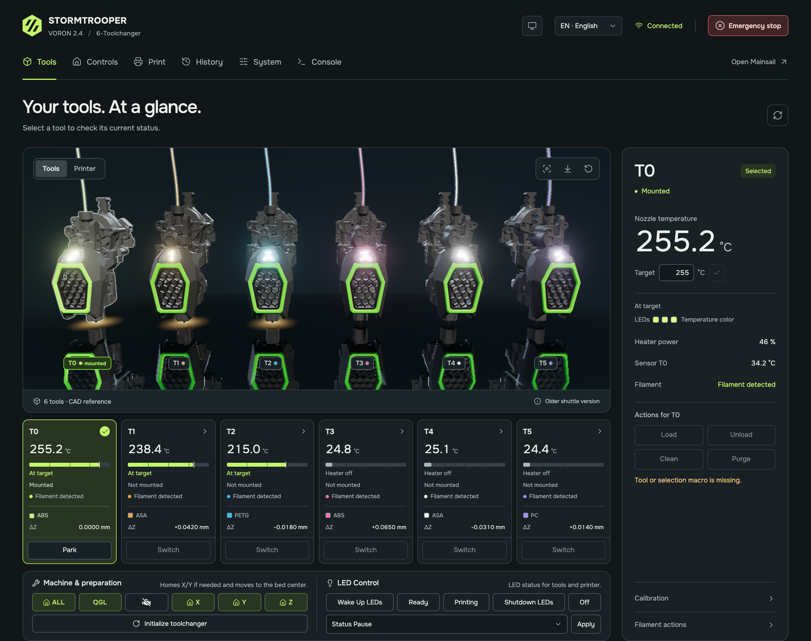
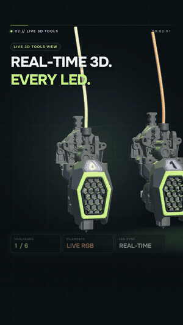
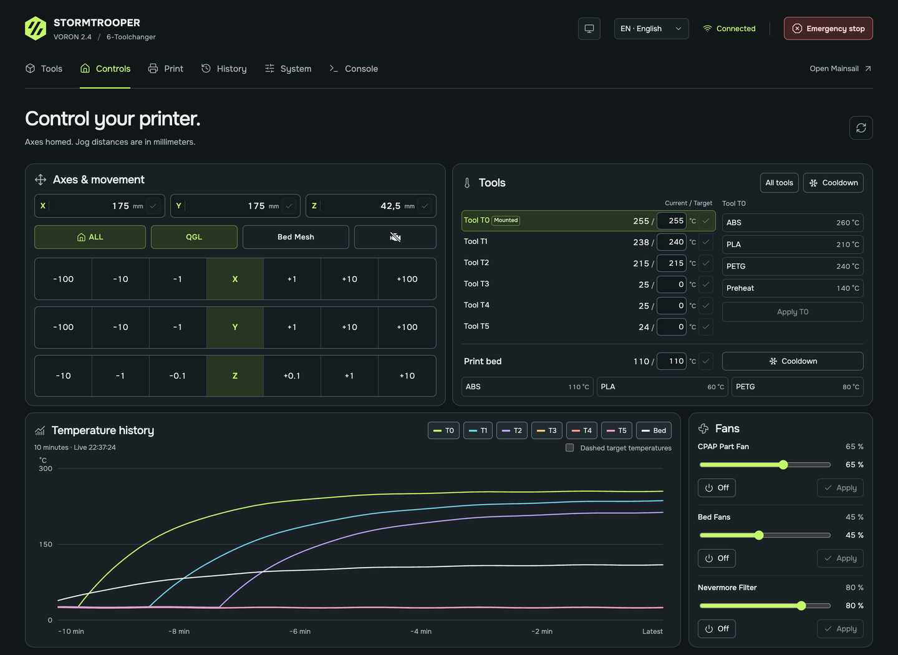
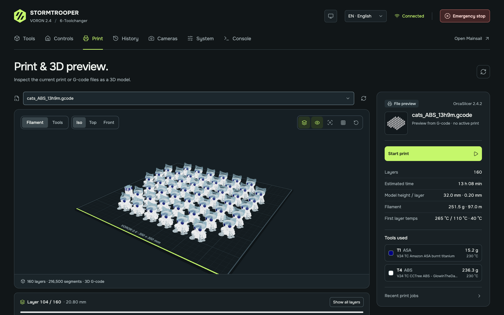
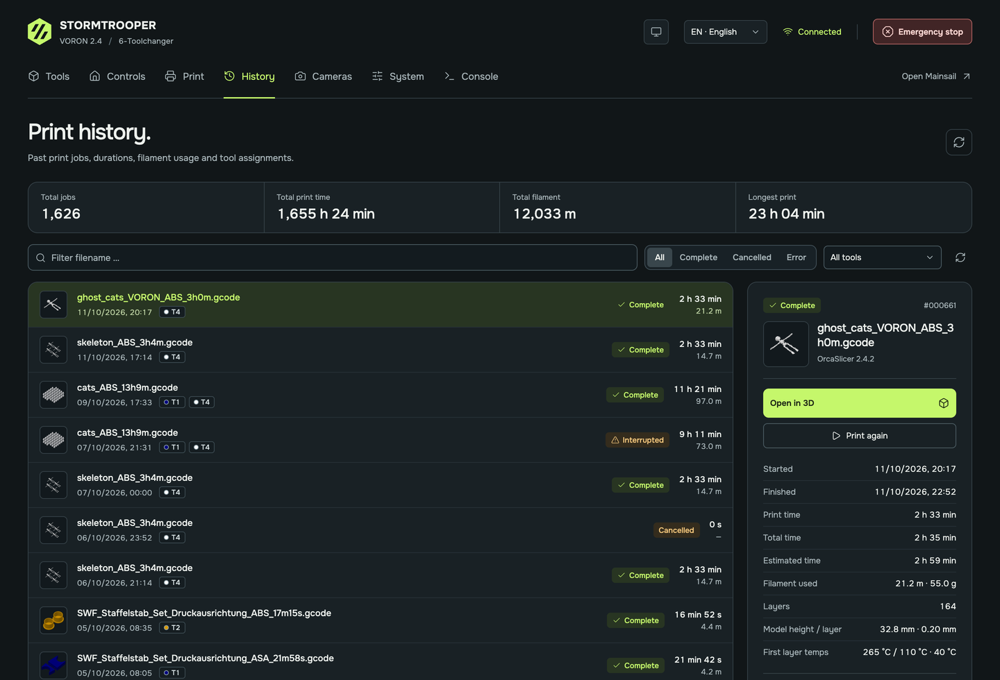
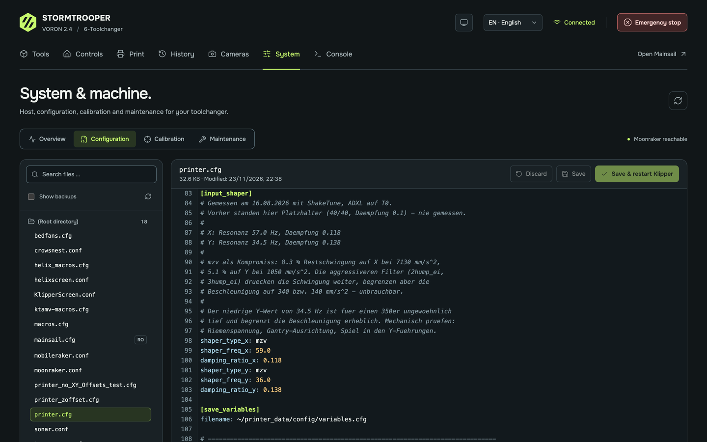
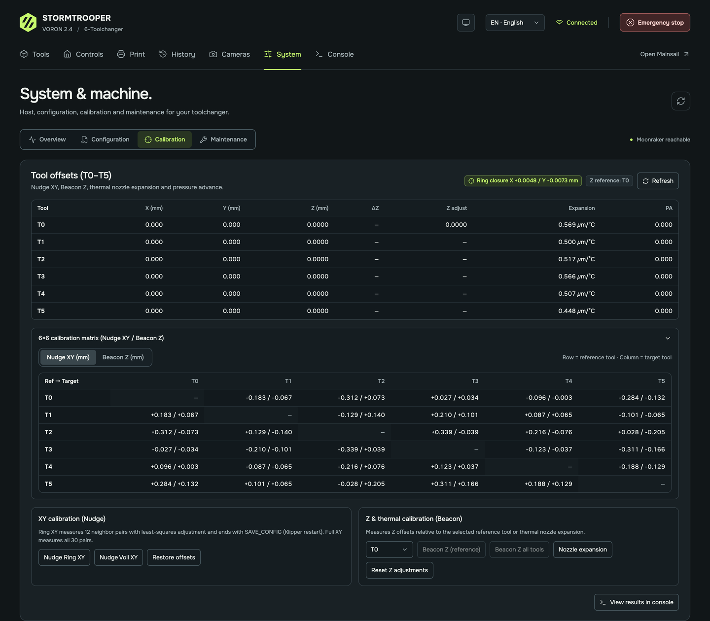

# VORON 2.4 Toolchanger Cockpit (STORMTROOPER)


A custom **English / German** real-time 3D cockpit for a six-tool **VORON 2.4 Toolchanger** running Klipper, Moonraker and Mainsail. Built with **Vue 3 + Three.js** and a zero-dependency **Node.js 22+** backend — featuring real Fusion CAD geometry, live per-head LED sync, glowing thermal nozzle radiance, colored PTFE filament feeds, a volumetric 3D G-code viewer, CodeMirror 6 Klipper config editor and a 6×6 Nudge XY / Beacon Z calibration workbench.



*Live 3D Tools Cockpit showing real LED states, OrcaSlicer filament colors, thermal nozzle radiance, calibrated ΔZ offsets, and the compact 1-tap Machine & LED deck.*

This is an independent, printer-specific application, not a Mainsail fork or a universal toolchanger configuration. It does not install or replace your printer macros.

---

## Showcase Video

<table>
  <tr>
    <td width="340" align="center">
      <a href="https://github.com/PrintStructor/voron-2.4-toolchanger-cockpit/releases/download/v1.0.0/stormtrooper-reel-tools-v3-logic.mp4">
        
      </a>
    </td>
    <td valign="middle">
      <h3>6 Tools. One Live 3D View.</h3>
      <p>
        Watch the full <strong>1080×1920 · 60 fps HD showcase video</strong> featuring live Three.js CAD flybys, sequential LED &amp; colored PTFE filament wake-up, real-time 255 °C thermal nozzle glow, hardware match-cut, and Tools cockpit close-ups — scored in Logic Pro Creator Studio.
      </p>
      <p>
        ▶ <a href="https://github.com/PrintStructor/voron-2.4-toolchanger-cockpit/releases/download/v1.0.0/stormtrooper-reel-tools-v3-logic.mp4"><strong>Watch / Download Tools Hero Cut (26 s · 60 fps · Logic Pro Audio)</strong></a><br/>
        ▶ <a href="https://github.com/PrintStructor/voron-2.4-toolchanger-cockpit/releases/download/v1.0.0/stormtrooper-reel-instagram-v2.mp4"><strong>Watch / Download Extended 6-Tab Walkthrough (34 s · 60 fps)</strong></a><br/>
        📦 <a href="https://github.com/PrintStructor/voron-2.4-toolchanger-cockpit/releases/tag/v1.0.0"><strong>View Release v1.0.0 Assets</strong></a>
      </p>
    </td>
  </tr>
</table>

---

## Screenshots

<table>
  <tr>
    <td width="50%">
      <strong>Tools · Live 3D CAD, LEDs, Filament RGB &amp; 1-Tap Deck</strong><br/>
      
    </td>
    <td width="50%">
      <strong>Controls · Motion, Presets, 10-Min Thermal Curves &amp; Fans</strong><br/>
      
    </td>
  </tr>
  <tr>
    <td width="50%">
      <strong>Print · Volumetric 3D G-Code Viewer &amp; Layer Scrubber</strong><br/>
      
    </td>
    <td width="50%">
      <strong>History · Moonraker Lifetime Stats, Tool Filters &amp; Open in 3D</strong><br/>
      
    </td>
  </tr>
  <tr>
    <td width="50%">
      <strong>System · CodeMirror 6 Klipper Config Editor &amp; Auto-Backups</strong><br/>
      
    </td>
    <td width="50%">
      <strong>System · 6×6 Nudge XY / Beacon Z Matrix &amp; Thermal Expansion</strong><br/>
      
    </td>
  </tr>
</table>

---

## Features

- **Live 3D Toolhead Cockpit (`T0–T5`):** Select and focus individual toolheads in Three.js with idle-zero GPU rendering (re-renders only when LEDs, filament states, selection or camera actually change). Live nozzle temperatures, glowing thermal nozzle radiance, heater power, tool detection, two nozzle LEDs and illuminated tool numbers.
- **Reflective Studio Floor & Colored PTFE Feeds:** Filament appears only when an enabled inlet sensor detects it; color comes directly from the active OrcaSlicer file when its six material slots can be mapped unambiguously.
- **Compact 1-Tap Machine & LED Deck:** Homing (`ALL`, `QGL`, `X`, `Y`, `Z`), `Initialize toolchanger`, and LED status mood presets sit cleanly flush underneath the `T0–T5` cards.
- **Relative Calibrated Z Offsets:** Displays offsets based on the initial tool, with unknown values left explicitly unknown.
- **WebSocket-Serialized Tool & Filament Actions:** Individual park, pickup, load, unload, nozzle clean and purge actions execute over Moonraker's `/websocket` endpoint (avoiding 60 s Nginx HTTP proxy timeouts) with live step progress and elapsed duration; bulk filament actions run step-by-step and abort cleanly on emergency stop.
- **Loading Assistant:** Supports `LOAD_WATCH` / `LOAD_WATCH_STOP`, with confirmed armed state shown in Acid-Lime green. Installed macros manage their own temperatures.
- **Precision Controls & Live Thermal History:** Direct X/Y/Z coordinate inputs, jogging, QGL, bed mesh, inline heater targets, Mainsail material presets, 140 °C preheat, independent bed cooldown, print-safe global cooldown (blocked during active print, allowed while paused), two-step confirmation for releasing motors when QGL is applied, CPAP / bed / Nevermore fan sliders, and 10-minute interactive temperature curves with SSE updates.
- **Dual WebRTC + MJPEG Cameras:** Persistent `camera-streamer` WebRTC + MJPEG dual streams with automatic fallback, stall detection/auto-reconnect, manual transport toggle and seamless tab switching without tearing down streams.
- **Volumetric 3D G-Code Print Viewer:** Dedicated **Print** tab rendering multi-tool G-code on a 350 × 350 mm VORON build plate with per-tool OrcaSlicer filament/tool coloring, support toggle, interactive layer scrubber (solid-vs-ghost remaining preview and live layer tracking during prints), print metadata and tool weight breakdown.
- **Print History Analytics:** Dedicated **History** tab showing Moonraker lifetime totals, searchable/filterable job history (by status, filename, single tool `T0–T5` or multi-tool prints), job detail inspector and one-click **Open in 3D** jump directly into the 3D Print viewer.
- **System & Machine Workbench:** Host overview, **CodeMirror 6** Klipper configuration editor with custom Klipper/Jinja2 syntax highlighting, diff review, auto-backups and guarded restart, **6×6 Calibration Matrix** (`Nudge XY` ring closure, `Beacon Z` probing, thermal nozzle expansion & ShakeTune charts), plus service/update/log maintenance.
- **Real-Time Console & DE/EN UI:** Live console via Moonraker WebSocket `notify_gcode_response` with persistent command history across tabs/reloads, plus instant DE/EN language switching in the header.

---

## Run locally

Requires **Node.js 22.12 or newer** and npm. The backend uses native WebSocket, fetch and environment-file support; Node 18 is not supported.

```sh
git clone https://github.com/PrintStructor/voron-2.4-toolchanger-cockpit.git
cd voron-2.4-toolchanger-cockpit
npm ci
cp .env.example .env.local
```

Edit `.env.local` to point to your printer's **Mainsail nginx origin** (port 80), which exposes Moonraker API routes, `/websocket`, and `/webcam` / `/webcam2`. Set `VITE_MAINSAIL_URL` to the Mainsail URL reachable by your browser (or `auto` when hosted directly on the printer). The example points to loopback; replace it when running on another machine. `.env.local` stays out of Git.

```sh
npm run dev
```

Open **http://127.0.0.1:4173/**. For a production build without Vite at runtime:

```sh
npm test
npm run build
npm start
```

`npm start` runs the standalone zero-dependency Node.js server (`server/start.mjs`), serving both `dist/` and the `/api/*` backend with `requestTimeout = 0` for SSE streams. `npm run dev`, `npm run preview` and `npm start` use the same default port (`4173`), so run one at a time. Serving `dist/` alone, including through GitHub Pages, will not provide live status, streams or controls.

---

## Hosting on a printer / LAN host

To run the cockpit directly on your printer host (e.g. Raspberry Pi 4 with Node.js >= 22.12):

### Option A — 1-command deploy over SSH (isolated Node 22 + user-level systemd)

```sh
./scripts/deploy-pi.sh printer.local
```

This runs `npm test` and `VITE_MAINSAIL_URL=auto npm run build` locally, installs an isolated SHA256-verified Node.js 22 LTS runtime into `~/.local/node22` on the host (leaving system `/usr/bin/node` untouched), syncs only runtime files (`dist/`, `server/`, `src/`, `package.json`), generates a host-local `.env.local` with detected LAN origins, and manages [deploy/stormtrooper-cockpit.user.service.example](deploy/stormtrooper-cockpit.user.service.example) under `~/.config/systemd/user/stormtrooper-cockpit.service`. Existing printer services (Klipper, Moonraker, HelixScreen, Mainsail, Crowsnest) are never modified. For 24/7 operation across SSH exits and reboots, enable systemd user linger once on the host:

```sh
sudo loginctl enable-linger "$USER"
```

### Option B — Manual / system-wide systemd service

1. Build the frontend once (`npm ci && VITE_MAINSAIL_URL=auto npm run build`).
2. Configure `HOST=0.0.0.0` (or `HOST=::` for dual-stack IPv4/IPv6), `PORT=4173`, `PRINTER_URL=http://127.0.0.1` and explicit trusted LAN origins in `ALLOWED_ORIGINS` (e.g. `ALLOWED_ORIGINS=http://printer.local:4173`).
3. Start via `npm start` or adapt the example systemd unit in [deploy/stormtrooper-cockpit.service.example](deploy/stormtrooper-cockpit.service.example).

The backend checks exact request origins against loopback and `ALLOWED_ORIGINS`, plus `X-Cockpit-Request: 1` and JSON content-type. It has no remote authentication layer: keep it on a trusted local network rather than exposing it to the internet.

---

## Printer integration

The current adapter expects six tools (`T0`–`T5`), `extruder` through `extruder5`, `tool Tn`, `neopixel etn_leds`, `filament_switch_sensor Tn_filament_sensor`, and the extended toolchanger status fields. Camera paths are `/webcam` and `/webcam2` (supporting both `/webrtc` via `camera-streamer` and `/stream` via MJPEG).

Actions are discovered and checked against the printer configuration. The supported macro family includes `PARK_TOOLHEAD`, `PICKUP_TOOL`, `LOAD_FILAMENT`, `UNLOAD_FILAMENT`, `CLEAN_NOZZLE`, `PURGE_NOZZLE`, `LOAD_WATCH`, `LOAD_WATCH_STOP`, `INITIALIZE_TOOLCHANGER`, `PAUSE`, `RESUME`, and the configured LED status macros. Load/unload defaults come from live `_LOAD_SETTINGS` / `_UNLOAD_SETTINGS` variables; the UI does not override them.

Review `server/control.mjs`, `server/tool-actions.mjs` and `server/aux-controls.mjs` before adapting to a different printer. Missing prerequisites disable actions. Tool selection in CAD changes the view only. Pickup requires an empty carriage. Macro-specific motion limits in this project must match your hardware.

For initial-tool-relative offsets, the small optional patch in `patches/toolchanger-initial-tool-status.patch` exposes `initial_tool` and `initial_tool_number`. Check whether your installed extension already provides them before applying it. No patch is applied automatically.

---

## Commands and safety

Buttons use validated actions. The console intentionally accepts direct G-code/macros, which can move or heat the printer. Type or insert a command, then press Enter or Send. Input and language changes alone send no commands.

The local backend serializes actions over Moonraker's WebSocket JSON-RPC API and never retries uncertain commands. Emergency stop bypasses the normal queue over HTTP and aborts any running multi-step bulk sequence immediately.

---

## CAD and attribution

The model is based on the owner's Fusion assembly, **VORON 2.4 Toolchanger 6 Head**. It includes older docks without KNOMI and an older rear shuttle. The 3D scene is a CAD reference, not a live simulation of carriage positions. Mesh provenance and optimization details are in `public/models/provenance.json`.

Export helpers are in `scripts/`. Set `STORMTROOPER_EXPORT_ROOT` before running the Fusion scripts against the expected document. The optimization script consumes an explicit raw-export directory.

See [NOTICE.md](NOTICE.md) for sources and dependency attribution. No blanket license for upstream designs, logos or CAD components is implied by this repository.

---

## Deutsch

DE/EN lässt sich oben umschalten und bleibt im Browser gespeichert. Das Cockpit ist für einen konkreten VORON 2.4 mit sechs Tools ausgelegt; Makronamen, Sensoren und Bewegungsgrenzen müssen zum eigenen Drucker passen. Die Installation steht oben. Druckeradresse ausschließlich in `.env.local` eintragen. `npm run dev` startet die lokale Entwicklungsoberfläche, `npm run build && npm start` den eigenständigen Produktionsserver ohne Vite (`deploy/stormtrooper-cockpit.service.example` für systemd). GitHub Pages ersetzt den benötigten Backend-Dienst nicht.
