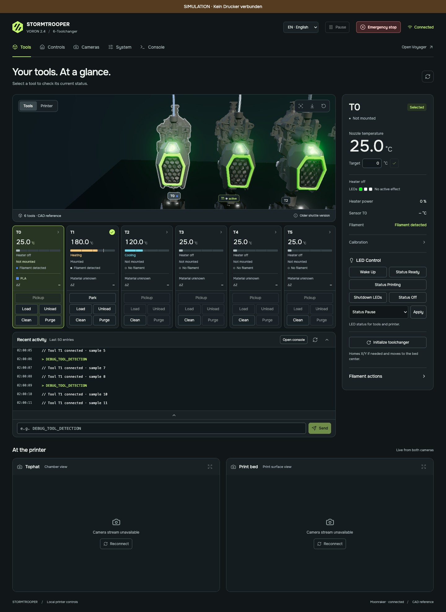

# STORMTROOPER Toolchanger Cockpit

A local **German / English** cockpit for a six-tool VORON 2.4 running Klipper, Moonraker and Voyager. Vue 3 + Three.js, with real CAD geometry, live tool/LED states, printer controls and a console.



*Preview uses simulated data; no printer commands were sent for verification.*

This is an independent, printer-specific application, not a Voyager fork or a universal toolchanger configuration. It does not install or replace your printer macros.

## Features

- Select and focus T0–T5 in 3D with idle-zero GPU rendering (re-renders only when LEDs, filament states, selection or camera actually change). Live nozzle temperatures, heater power, tool detection, two nozzle LEDs and illuminated tool numbers.
- Reflective floor and PTFE feeds. Filament appears only when an enabled inlet sensor detects it; color comes from the active OrcaSlicer file when its six material slots can be mapped unambiguously.
- Relative calibrated Z offsets based on the initial tool, with unknown values left unknown.
- Individual park, pickup, load, unload, nozzle clean and purge actions. Long-running actions execute over Moonraker's `/websocket` endpoint (avoiding 60 s Nginx HTTP proxy timeouts) with live step progress and elapsed duration; bulk filament actions run step-by-step and abort cleanly on emergency stop.
- Loading assistant using `LOAD_WATCH` / `LOAD_WATCH_STOP`, with confirmed armed state shown in lime green. Installed macros manage their own temperatures.
- Homing, jogging, QGL, bed mesh, inline heater targets, material presets, 140 °C preheat, independent bed cooldown, print-safe global cooldown (blocked during active print, allowed while paused), two-step confirmation for releasing motors when QGL is applied, and fan controls.
- Persistent **WebRTC (`camera-streamer`) + MJPEG** dual camera streams with automatic fallback, stall detection/auto-reconnect, manual transport toggle and seamless tab switching without tearing down streams.
- Dedicated **Print** tab with a volumetric **Three.js 3D G-code model viewer** on a 350 × 350 mm VORON build plate, per-tool OrcaSlicer filament/tool coloring, support toggle, interactive layer scrubber (with solid-vs-ghost remaining preview and live layer tracking during prints), print metadata, used tool breakdown and recent Moonraker job history.
- Ten-minute interactive temperature history with hover crosshair/tooltip and live SSE updates between authoritative polls, LED presets, toolchanger initialization, compact active print job status bar, print pause/resume, global command recovery banner and emergency stop.
- Real-time console via Moonraker WebSocket `notify_gcode_response` (collapsible recent-activity console below T0–T5 and full console view) with command history persisted across tabs and reloads.
- DE/EN selection in the header, saved in the browser. Language changes preserve draft temperatures and tool selection. Raw G-code and Klipper output remain unchanged.

## Run locally

Requires **Node.js 22.12 or newer** and npm. The backend uses native WebSocket, fetch and environment-file support; Node 18 is not supported.

```sh
git clone https://github.com/PrintStructor/stormtrooper-toolchanger-cockpit.git
cd stormtrooper-toolchanger-cockpit
npm ci
cp .env.example .env.local
```

Edit `.env.local` to point to your printer's **Voyager nginx origin**, which exposes Moonraker API routes, `/websocket`, and `/webcam` / `/webcam2`. Set `VITE_VOYAGER_URL` to the Voyager URL reachable by your browser. The example points to loopback; replace it when running on another machine. `.env.local` stays out of Git.

```sh
npm run dev
```

Open **http://127.0.0.1:4173/**. For a production build without Vite at runtime:

```sh
npm test
npm run build
npm start
```

`npm start` runs the standalone zero-dependency Node.js server (`server/start.mjs`), serving both `dist/` and the `/api/*` backend with `requestTimeout = 0` for SSE streams. `npm run dev`, `npm run preview` and `npm start` use the same default port (`4173`), so run one at a time. Serving `dist/` alone, including through GitHub Pages, will not provide live status, streams or controls.

## Hosting on a printer / LAN host

To run the cockpit directly on your printer host (e.g. Raspberry Pi with Node.js >= 22.12):

1. Build the frontend once (`npm ci && npm run build`).
2. Configure `HOST=0.0.0.0`, `PORT=4173`, `PRINTER_URL=http://127.0.0.1:1977` and explicit trusted LAN origins in `ALLOWED_ORIGINS` (e.g. `ALLOWED_ORIGINS=http://printer.local:4173`).
3. Start via `npm start` or adapt the example systemd unit in [deploy/stormtrooper-cockpit.service.example](deploy/stormtrooper-cockpit.service.example).

The backend checks exact request origins against loopback and `ALLOWED_ORIGINS`, plus `X-Cockpit-Request: 1` and JSON content-type. It has no remote authentication layer: keep it on a trusted local network rather than exposing it to the internet.

## Printer integration

The current adapter expects six tools (`T0`–`T5`), `extruder` through `extruder5`, `tool Tn`, `neopixel etn_leds`, `filament_switch_sensor Tn_filament_sensor`, and the extended toolchanger status fields. Camera paths are `/webcam` and `/webcam2` (supporting both `/webrtc` via `camera-streamer` and `/stream` via MJPEG).

Actions are discovered and checked against the printer configuration. The supported macro family includes `PARK_TOOLHEAD`, `PICKUP_TOOL`, `LOAD_FILAMENT`, `UNLOAD_FILAMENT`, `CLEAN_NOZZLE`, `PURGE_NOZZLE`, `LOAD_WATCH`, `LOAD_WATCH_STOP`, `INITIALIZE_TOOLCHANGER`, `PAUSE`, `RESUME`, and the configured LED status macros. Load/unload defaults come from live `_LOAD_SETTINGS` / `_UNLOAD_SETTINGS` variables; the UI does not override them.

Review `server/control.mjs`, `server/tool-actions.mjs` and `server/aux-controls.mjs` before adapting to a different printer. Missing prerequisites disable actions. Tool selection in CAD changes the view only. Pickup requires an empty carriage. Macro-specific motion limits in this project must match your hardware.

For initial-tool-relative offsets, the small optional patch in `patches/toolchanger-initial-tool-status.patch` exposes `initial_tool` and `initial_tool_number`. Check whether your installed extension already provides them before applying it. No patch is applied automatically.

## Commands and safety

Buttons use validated actions. The console intentionally accepts direct G-code/macros, which can move or heat the printer. Type or insert a command, then press Enter or Send. Input and language changes alone send no commands.

The local backend serializes actions over Moonraker's WebSocket JSON-RPC API and never retries uncertain commands. Emergency stop bypasses the normal queue over HTTP and aborts any running multi-step bulk sequence immediately.

## CAD and attribution

The model is based on the owner's Fusion assembly, **VORON 2.4 Toolchanger 6 Head**. It includes older docks without KNOMI and an older rear shuttle. The 3D scene is a CAD reference, not a live simulation of carriage positions. Mesh provenance and optimization details are in `public/models/provenance.json`.

Export helpers are in `scripts/`. Set `STORMTROOPER_EXPORT_ROOT` before running the Fusion scripts against the expected document. The optimization script consumes an explicit raw-export directory.

See [NOTICE.md](NOTICE.md) for sources and dependency attribution. No blanket license for upstream designs, logos or CAD components is implied by this repository.

## Deutsch

DE/EN lässt sich oben umschalten und bleibt im Browser gespeichert. Das Cockpit ist für einen konkreten VORON mit sechs Tools ausgelegt; Makronamen, Sensoren und Bewegungsgrenzen müssen zum eigenen Drucker passen. Die Installation steht oben. Druckeradresse ausschließlich in `.env.local` eintragen. `npm run dev` startet die lokale Entwicklungsoberfläche, `npm run build && npm start` den eigenständigen Produktionsserver ohne Vite (`deploy/stormtrooper-cockpit.service.example` für systemd). GitHub Pages ersetzt den benötigten Backend-Dienst nicht.
